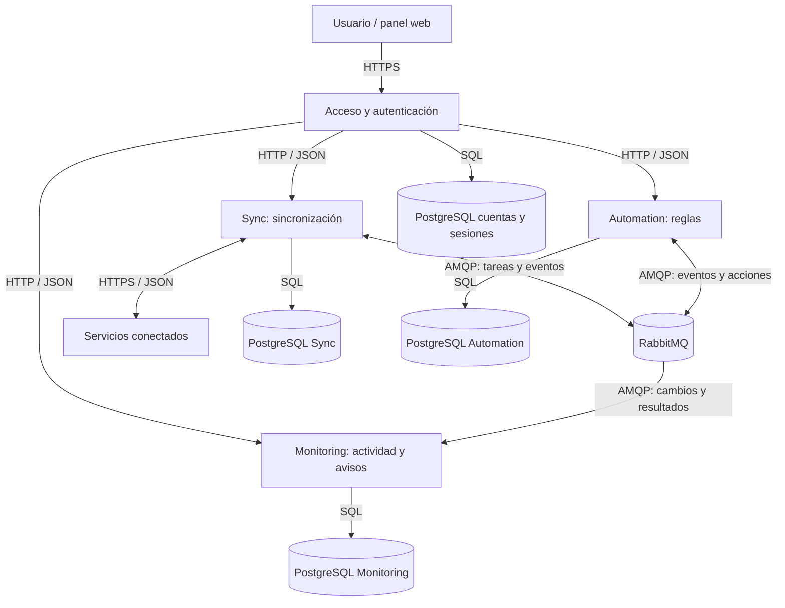
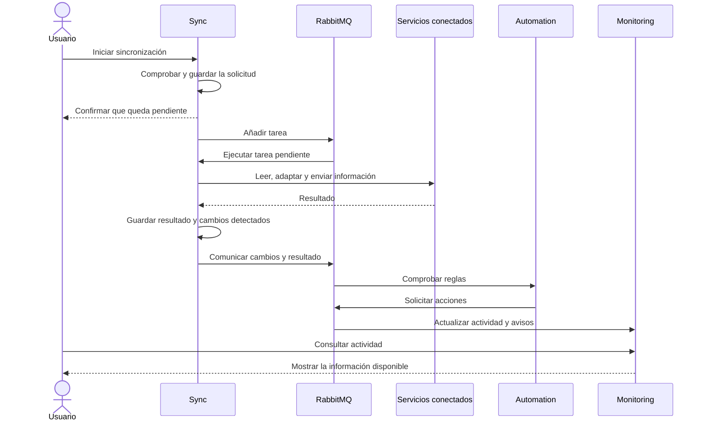

# Synkron

Synkron nace de la necesidad de mantener conectadas las herramientas que usamos a diario. Busca reunir su actividad, sincronizar información y automatizar acciones para reducir el trabajo de revisar y actualizar cada aplicación por separado.

Es un proyecto en desarrollo. Las funciones descritas recogen el diseño previsto.

## Qué permitirá hacer

- Conectar servicios y elegir qué información compartir entre ellos.
- Adaptar los datos cuando dos aplicaciones los guardan de forma distinta.
- Detectar cambios durante las sincronizaciones y crear reglas para responder a ellos.
- Recibir avisos y consultar qué ha cambiado, qué se ha completado y qué necesita atención.
- Revisar el historial y el resultado de las operaciones desde un panel web.

El uso personal es el punto de partida. Cada cuenta tendrá sus propias conexiones, reglas e historial, por lo que otras personas podrán utilizar la plataforma con sus herramientas y necesidades.

La primera versión se centrará en sincronizaciones iniciadas por el usuario y reglas que respondan a sus resultados y a los cambios detectados. La ejecución programada se añadirá después. Las conexiones se configurarán mediante las API que ofrezcan los servicios, sin depender de una aplicación concreta.

## Cómo se organiza

Synkron se divide en tres servicios:

| Servicio | Qué hace |
|---|---|
| **Sync** | Conecta las aplicaciones, adapta su información y ejecuta las sincronizaciones. |
| **Automation** | Comprueba las reglas del usuario y pone en marcha las acciones que correspondan. |
| **Monitoring** | Reúne los cambios, avisos y resultados para poder consultarlos. |

Los servicios se desarrollarán con NestJS y TypeScript. El panel web utilizará React y TypeScript, con Vite para el desarrollo y la compilación.

Una API, la interfaz por la que se comunican las aplicaciones, recibe las peticiones del panel web y las dirige al servicio correspondiente. También se comprueba quién accede y qué información le pertenece.

Cada persona tendrá una cuenta con correo y contraseña. La sesión se guardará en el servidor y el navegador conservará una cookie protegida para identificarla. Cerrar sesión o dejarla caducar impedirá seguir utilizándola. Las contraseñas no se guardarán en texto legible y cada servicio comprobará que los datos solicitados pertenecen a la cuenta.

RabbitMQ guarda los mensajes pendientes y los reparte entre los servicios. Esto permite realizar una sincronización larga en segundo plano y comunicar su resultado sin mantener al usuario esperando.

Cada backend tendrá su propia base de datos PostgreSQL en un contenedor independiente: Sync, Automation, Monitoring y el componente de cuentas y sesiones de la entrada API. Cada base tendrá credenciales y un volumen persistente propios. Los servicios intercambian información por HTTP y mensajes, sin acceder a las bases de otros servicios. Cada usuario solo puede acceder a sus propios recursos.

Una sincronización recorre este camino:

La información del panel puede tardar un poco en actualizarse. Si una operación falla, se conserva el resultado para poder revisarlo. Repetir un envío sin crear duplicados también depende de lo que permita la aplicación de destino.

## Uso de la nube

La cantidad de trabajo puede variar según las conexiones y la frecuencia de uso de cada persona. La separación en servicios permite dedicar más capacidad a las sincronizaciones cuando sea necesario.

Las cinco características de [NIST SP 800-145](https://doi.org/10.6028/NIST.SP.800-145) se relacionan con el diseño de esta forma:

| Característica | Aplicación en Synkron |
|---|---|
| Autoservicio bajo demanda | Cada persona configura sus conexiones y solicita operaciones desde su cuenta. |
| Acceso amplio a la red | El panel y la API se utilizan a través de la red. |
| Agrupación de recursos | Los usuarios comparten infraestructura, manteniendo separados sus datos y permisos. |
| Rápida elasticidad | Se podrán aumentar y reducir los procesos que ejecutan sincronizaciones según el trabajo pendiente. |
| Servicio medido | Se registra cuántas operaciones se realizan, cuánto tardan y cuántos datos procesan. |

La capacidad de ampliar recursos se comprobará cuando exista un despliegue. Medir el uso servirá para conocer sus límites y controlar el coste de funcionamiento.

El modelo de [NIST SP 500-292](https://doi.org/10.6028/NIST.SP.500-292) distingue estos actores:

| Actor | Papel en Synkron e impacto económico |
|---|---|
| Consumidor | Persona que utiliza Synkron para ahorrar tiempo y reducir tareas repetidas. |
| Proveedor | Quien mantiene Synkron en funcionamiento y asume los costes de alojamiento y mantenimiento. |
| Intermediario | Synkron reúne e integra servicios; cuando conecta servicios cloud, puede actuar como intermediario entre ellos y el usuario, reduciendo el trabajo de integración. |
| Auditor | Persona o entidad independiente que revisa seguridad, privacidad y funcionamiento para detectar riesgos. |
| Operador | Proveedor de conectividad, cuyo coste y disponibilidad afectan al acceso a la plataforma. |

## API

Las rutas parten de `/api/v1`. Los datos se intercambian en JSON y el acceso se limita a la cuenta autenticada.

| Método | Ruta | Para qué sirve |
|---|---|---|
| `POST` | `/auth/register` | Crear una cuenta. |
| `POST` | `/auth/login` | Acceder a la cuenta. |
| `POST` | `/auth/logout` | Cerrar la sesión actual. |
| `GET` | `/auth/session` | Consultar la cuenta y la sesión actual. |
| `GET`, `POST` | `/connections` | Consultar o añadir conexiones. |
| `POST` | `/connections/{id}/test` | Comprobar una conexión. |
| `GET`, `POST` | `/sync-definitions` | Consultar o definir sincronizaciones. |
| `POST` | `/sync-definitions/{id}/runs` | Iniciar una sincronización. |
| `GET` | `/sync-runs/{id}` | Consultar su estado y resultado. |
| `GET`, `POST` | `/automations` | Consultar o crear reglas. |
| `GET` | `/activity` | Consultar cambios y operaciones. |
| `GET` | `/notifications` | Consultar avisos. |
| `GET` | `/usage` | Consultar el uso de la plataforma. |

Al crear una conexión se indican nombre, dirección y forma de acceso. Una sincronización relaciona origen, destino y campos que deben adaptarse. Una regla establece qué evento la activa, qué condiciones debe cumplir y qué acciones realizará.

## Trabajo en el repositorio

`main` mantiene la versión estable del proyecto. Cada cambio se prepara en una rama aparte y se incorpora mediante una pull request, donde se revisa qué se ha modificado y cómo se ha comprobado.

Los mensajes de commit llevan un prefijo que indica el tipo de cambio: `feat:` para nuevas funciones, `fix:` para correcciones, `docs:` para documentación y `refactor:` para reorganizar código sin cambiar su funcionamiento.

## Documentación

Los [casos de uso](docs/casos-de-uso.md) y los [requisitos](docs/requisitos.md) describen las funciones previstas. La [arquitectura](docs/arquitectura.md), las [decisiones de diseño](docs/decisiones.md) y la [API](docs/api.md) recogen el detalle de funcionamiento.
