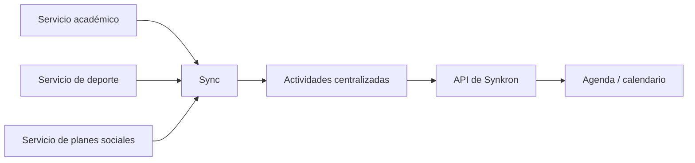
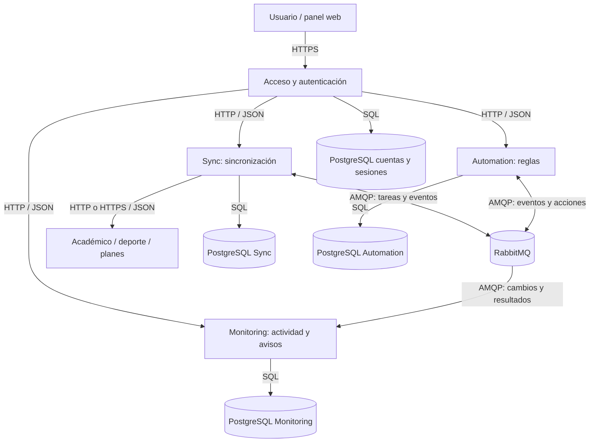
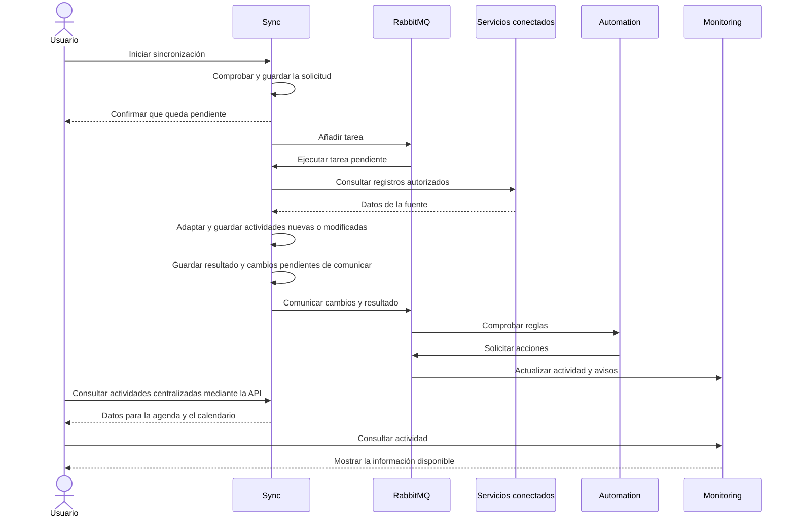

# Synkron

Synkron conecta servicios de la vida personal y reúne sus actividades en un espacio común. Recoge información académica, deportiva y de planes sociales, adapta sus formatos y mantiene una colección centralizada que se consulta desde una agenda o calendario.

Es un proyecto en desarrollo. La autenticación y la gestión básica de conexiones ya funcionan; el motor, las fuentes editables y el calendario descritos a continuación siguen pendientes de implementación.

## Qué permitirá hacer

- Conectar fuentes académicas, deportivas y de planes sociales y elegir qué actividades incorporar.
- Adaptar sus campos y fechas a una representación común, conservando la procedencia y los detalles relevantes.
- Consultar juntas las actividades sincronizadas en una agenda o calendario propio.
- Detectar cambios durante las sincronizaciones y crear reglas para responder a ellos.
- Recibir avisos y consultar qué ha cambiado, qué se ha completado y qué necesita atención.
- Revisar el historial y el resultado de las operaciones desde un panel web.

Cada cuenta tendrá sus propias conexiones, actividades, reglas e historial. El motor será reutilizable con los servicios del proyecto personal o con otras fuentes compatibles; el calendario es una vista de esos datos y no condiciona los formatos de entrada.

La primera versión se centrará en sincronizaciones iniciadas por el usuario y reglas que respondan a sus resultados y a los cambios detectados. Sync consultará las fuentes y guardará las actividades en su propia base de datos. Cambiar un registro en el origen actualizará la actividad existente al volver a sincronizar. La ejecución programada se añadirá después.

## Fuentes y vista centralizada

Las tres fuentes de demostración son servicios independientes del motor:

| Fuente | Información que aporta |
|---|---|
| Académico | Entregas, exámenes, sesiones de estudio o trabajo y eventos generales. |
| Deporte | Gimnasio, fútbol, senderismo, carrera y otras actividades sencillas. |
| Planes sociales | Quedadas con fecha, hora, ubicación y participantes opcionales. |

Cada fuente permitirá introducir y actualizar datos propios, con persistencia. Una nota publicada después de un examen, un cambio de horario o una corrección de una sesión serán actualizaciones del registro original. Los campos y decisiones pendientes se recogen en [Servicios de origen](docs/servicios-origen.md).

Las actividades se crean y modifican en sus fuentes. Para la demostración habrá formularios sencillos de entrada; sus llamadas pasarán por un backend autorizado, sin entregar credenciales al navegador. La vista centralizada será de consulta. Synkron conserva la última información sincronizada, por lo que abrir el calendario no requiere volver a contactar con todas las fuentes.

## Cómo se organiza

Synkron se divide en tres servicios:

| Servicio | Qué hace |
|---|---|
| **Sync** | Consulta las fuentes, adapta sus datos y mantiene las actividades centralizadas y las ejecuciones. |
| **Automation** | Comprueba las reglas del usuario y pone en marcha las acciones que correspondan. |
| **Monitoring** | Reúne los cambios, avisos y resultados para poder consultarlos. |

Los servicios se desarrollarán con NestJS y TypeScript. El panel web utilizará React y TypeScript, con Vite para el desarrollo y la compilación.

Una API, la interfaz por la que se comunican las aplicaciones, recibe las peticiones del panel web y las dirige al servicio correspondiente. También se comprueba quién accede y qué información le pertenece.

Cada persona tendrá una cuenta con correo y contraseña. La sesión se guardará en el servidor y el navegador conservará una cookie protegida para identificarla. Cerrar sesión o dejarla caducar impedirá seguir utilizándola. Las contraseñas no se guardarán en texto legible y cada servicio comprobará que los datos solicitados pertenecen a la cuenta.

RabbitMQ guarda los mensajes pendientes y los reparte entre los servicios. Esto permite realizar una sincronización larga en segundo plano y comunicar su resultado sin mantener al usuario esperando.

Cada backend tendrá su propia base de datos PostgreSQL en un contenedor independiente: Sync, Automation, Monitoring y el componente de cuentas y sesiones de la entrada API. Cada base tendrá credenciales y un volumen persistente propios. Los servicios intercambian información por HTTP y mensajes, sin acceder a las bases de otros servicios. Cada usuario solo puede acceder a sus propios recursos.

Una sincronización recorre este camino:

Las actividades reflejan la última sincronización; el historial y los avisos pueden tardar un poco más en actualizarse al procesarse sus eventos. Si una operación falla, se conserva el resultado para revisarlo. Repetir una importación no debe duplicar las actividades ni sus avisos.

## Uso de la nube

La cantidad de trabajo puede variar según las conexiones y la frecuencia de uso de cada persona. La separación en servicios permite dedicar más capacidad a las sincronizaciones cuando sea necesario.

Las cinco características de [NIST SP 800-145](https://doi.org/10.6028/NIST.SP.800-145) se relacionan con el diseño de esta forma:

| Característica | Aplicación en Synkron |
|---|---|
| Autoservicio bajo demanda | Cada persona configura sus conexiones y solicita operaciones desde su cuenta. |
| Acceso amplio a la red | El panel y la API se utilizan a través de la red. |
| Agrupación de recursos | Los usuarios comparten infraestructura, manteniendo separados sus datos y permisos. |
| Rápida elasticidad | Se podrán aumentar y reducir los procesos que ejecutan sincronizaciones según el trabajo pendiente. |
| Servicio medido | Se registra cuántas operaciones se realizan, cuánto tardan y cuántos datos procesan. |

La capacidad de ampliar recursos se comprobará cuando exista un despliegue. Medir el uso servirá para conocer sus límites y controlar el coste de funcionamiento.

El modelo de [NIST SP 500-292](https://doi.org/10.6028/NIST.SP.500-292) distingue estos actores:

| Actor | Papel en Synkron e impacto económico |
|---|---|
| Consumidor | Persona que utiliza Synkron para ahorrar tiempo y reducir tareas repetidas. |
| Proveedor | Quien mantiene Synkron en funcionamiento y asume los costes de alojamiento y mantenimiento. |
| Intermediario | Synkron reúne e integra servicios; cuando conecta servicios cloud, puede actuar como intermediario entre ellos y el usuario, reduciendo el trabajo de integración. |
| Auditor | Persona o entidad independiente que revisa seguridad, privacidad y funcionamiento para detectar riesgos. |
| Operador | Proveedor de conectividad, cuyo coste y disponibilidad afectan al acceso a la plataforma. |

## API

Las rutas parten de `/api/v1`. Los datos se intercambian en JSON y el acceso se limita a la cuenta autenticada.

| Método | Ruta | Para qué sirve |
|---|---|---|
| `POST` | `/auth/register` | Crear una cuenta. |
| `POST` | `/auth/login` | Acceder a la cuenta. |
| `POST` | `/auth/logout` | Cerrar la sesión actual. |
| `GET` | `/auth/session` | Consultar la cuenta y la sesión actual. |
| `GET`, `POST` | `/connections` | Consultar o añadir conexiones. |
| `POST` | `/connections/{id}/test` | Comprobar una conexión. |
| `GET`, `POST` | `/sync-definitions` | Consultar o definir sincronizaciones. |
| `POST` | `/sync-definitions/{id}/runs` | Iniciar una sincronización. |
| `GET` | `/sync-runs/{id}` | Consultar su estado y resultado. |
| `GET` | `/activities` | Consultar actividades centralizadas; contrato pendiente de implementar. |
| `GET` | `/activities/{id}` | Consultar el detalle y procedencia de una actividad; previsto. |
| `GET`, `POST` | `/automations` | Consultar o crear reglas. |
| `GET` | `/activity` | Consultar cambios y operaciones. |
| `GET` | `/notifications` | Consultar avisos. |
| `GET` | `/usage` | Consultar el uso de la plataforma. |

Al crear una conexión se indican nombre, dirección y forma de acceso. Una sincronización define la fuente y la correspondencia de campos con las actividades centralizadas. El destino inicial es interno a Sync y no requiere una segunda conexión externa. Una regla establece qué evento la activa, qué condiciones debe cumplir y qué acciones realizará. El [contrato API](docs/api.md) distingue las rutas disponibles de las previstas; `/activities` representa las actividades personales y `/activity` el historial de Monitoring.

## Estado y cierre de implementación

Actualmente hay API de cuentas y sesiones, Sync con creación y listado paginado de conexiones sin autenticación o Bearer cifrado, prueba de conexión limitada a destinos autorizados, sus PostgreSQL independientes y una API ficticia estática de tareas. El [servicio académico](apps/academic/README.md) incorpora su propio PostgreSQL y una API autenticada de entregas con creación, consultas, edición completa, borrado lógico y exportación para Sync. Hay imágenes y comprobaciones de CI para estos backends. La migración de borrado y los escenarios de ciclo de vida de entregas también se han validado en el entorno local.

Quedan por implementar exámenes, sesiones y eventos académicos generales, las fuentes de deporte y planes sociales, las actividades centralizadas, el motor y sus ejecuciones, RabbitMQ, Automation, Monitoring y el frontend. También faltan operaciones de conexiones, almacenamiento de la última prueba, publicación de imágenes en GHCR y cierre del arranque y documentación completos. La API de entregas es una parte del servicio académico, que todavía debe ampliarse con sus otros recursos y formularios.

El objetivo de cierre del Hito 2 es la implementación funcional completa del alcance inicial acordado, con sus componentes integrados, pruebas, contenedores, CI y publicación de imágenes. Una primera sincronización o el mínimo de contenedores son checkpoints intermedios. Las funciones marcadas como posteriores u opcionales en [Requisitos](docs/requisitos.md) mantienen esa distinción. Infraestructura y despliegue corresponden al trabajo posterior; actualmente solo se configura CI.

## Trabajo en el repositorio

`develop` es la rama de trabajo y `main` mantiene la versión estable. Los cambios se comprueban en CI y las incorporaciones a `main` se revisan mediante pull request.

Los mensajes de commit llevan un prefijo que indica el tipo de cambio: `feat:` para nuevas funciones, `fix:` para correcciones, `docs:` para documentación y `refactor:` para reorganizar código sin cambiar su funcionamiento.

## Documentación

Los [casos de uso](docs/casos-de-uso.md) y los [requisitos](docs/requisitos.md) describen las funciones previstas. La [arquitectura](docs/arquitectura.md), las [decisiones de diseño](docs/decisiones.md) y la [API](docs/api.md) recogen el detalle de funcionamiento.

Los [servicios de origen](docs/servicios-origen.md) describen las entradas acordadas y los aspectos por concretar. El [backlog](docs/backlog.md) recoge los trabajos necesarios para completar la aplicación.

El [modelo común de actividades](docs/modelo-actividades.md) define identidad,
campos compartidos y reglas temporales para la próxima implementación.
