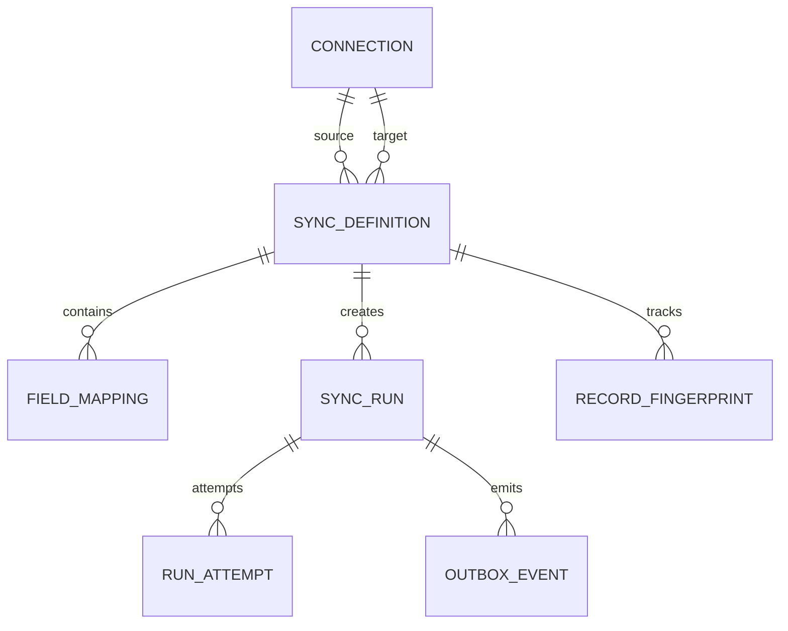
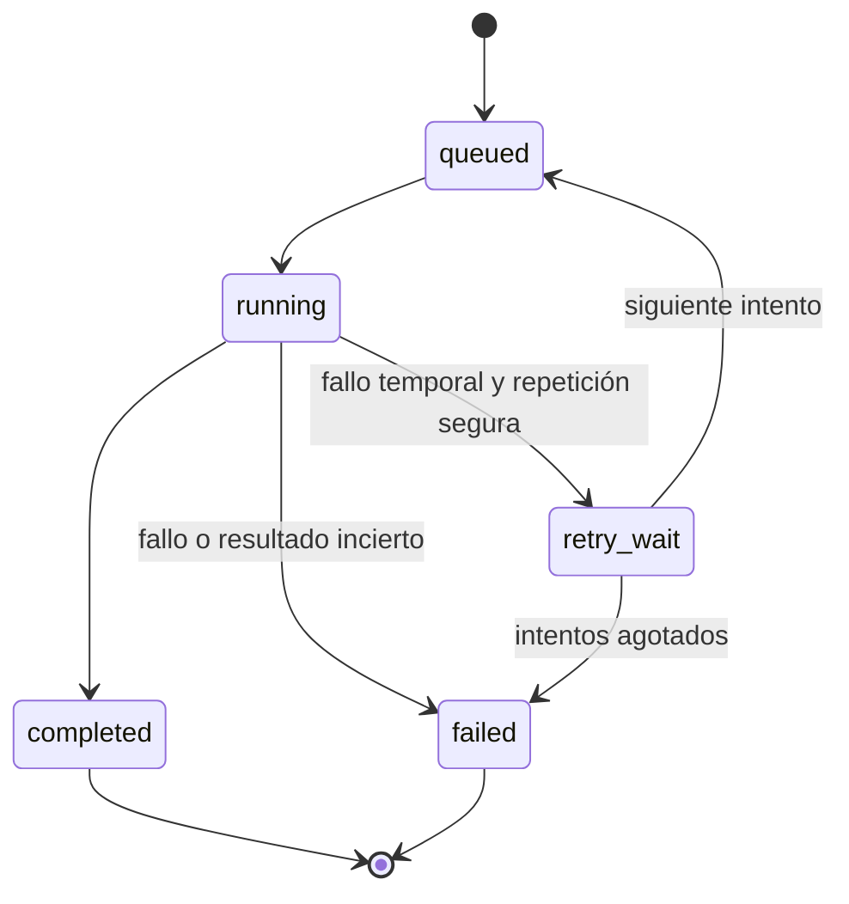

# Arquitectura

Los diagramas generales están en el [README](../README.md). Este documento explica cómo se reparte el trabajo y qué ocurre cuando algo falla.

## Servicios y datos

| Servicio | Trabajo y datos propios |
|---|---|
| Sync | Conexiones, sincronizaciones, comparación de datos y resultados. |
| Automation | Reglas, condiciones, acciones y su seguimiento. |
| Monitoring | Cambios, historial, avisos y estadísticas. |
| Acceso y cuentas | Registro, comprobación de contraseñas y sesiones propias, incluido en la entrada API de NestJS. |

Cada servicio se podrá ejecutar y actualizar por separado. Sync tendrá procesos en segundo plano para realizar las sincronizaciones. Se podrán añadir más si aumenta el trabajo.

PostgreSQL guardará los datos en grupos de tablas separados por servicio. Cada uno tendrá sus permisos y solo escribirá en sus tablas. La base inicial será compartida, así que una caída puede afectar a todo el sistema.

Cada cuenta tendrá sus propios recursos. El campo interno `tenant_id` identifica a su propietario.

Este modelo corresponde a Sync. Guarda las conexiones, la relación entre campos, las ejecuciones y una referencia del contenido ya procesado. Esa referencia permite distinguir datos nuevos, modificados y sin cambios entre revisiones.

## Sincronización y mensajes

Sync guarda la solicitud antes de aceptarla y deja pendiente el mensaje que permitirá ejecutarla. Ambos se guardan juntos para no perder el trabajo si el sistema se interrumpe. Otro proceso envía después el mensaje a RabbitMQ.

RabbitMQ reparte las tareas entre los procesos de Sync. Automation y Monitoring reciben por separado los eventos que les interesan. Cada servicio registra los mensajes procesados para no repetir sus efectos. Si debe pedir otra acción, guarda también esa petición antes de dar el mensaje por terminado.

Al confirmar un dato nuevo o modificado en el destino, Sync comunica `data.changed`. Incluye la referencia del registro y los campos afectados, sin copiar todo el contenido personal. Los eventos `sync.completed` y `sync.failed` indican el resultado de la sincronización.

Automation comprueba las reglas del usuario. La acción `notify` pide a Monitoring que guarde un aviso; `start_sync` pide a Sync otra sincronización de la misma cuenta. Las acciones conservan su origen y tienen un límite de encadenamiento para evitar bucles.

Los cambios se detectan durante cada revisión, manual al principio y programada más adelante. La primera versión no propaga borrados ni recibe cambios inmediatos mediante webhooks.

## Cuando algo falla

Sync guarda el estado de la ejecución. Monitoring lo recibe después, de modo que el panel puede tardar un poco en reflejarlo.

Los estados básicos son pendiente (`queued`), en curso (`running`), completada (`completed`) y fallida (`failed`). La espera de reintento (`retry_wait`) se añadirá con esa función.

Si una aplicación guarda un dato pero se pierde su respuesta, repetir el envío podría duplicarlo. Solo se repetirá automáticamente si el destino permite reconocer la operación o actualizar el mismo registro. En otro caso se guarda el error `external_outcome_unknown` para revisión.

Una sincronización incompleta puede haber cambiado parte de los datos. No se presupone que todos esos cambios puedan deshacerse. Los reintentos tendrán límite y esperas entre intentos; los mensajes que sigan fallando se apartarán para revisar su causa.

## Acceso y funcionamiento

El componente de acceso guarda cuentas y sesiones en sus propias tablas de PostgreSQL. El panel utiliza una cookie protegida y se sirve bajo el mismo origen que la API. La sesión caduca o se invalida al cerrarla, según [ADR-005](decisiones.md#adr-005-acceso-a-la-información-personal).

Cada servicio consulta la sesión al componente de acceso por una ruta interna autenticada y comprueba la propiedad del recurso antes de operar. Esa ruta no se expone a Internet y no acepta una identidad indicada libremente por el cliente. Si la comprobación falla o el componente no responde, se rechaza el acceso. Esto añade una dependencia de disponibilidad y una consulta interna a las peticiones autenticadas.

Las tareas y los eventos internos conservan el propietario de la operación aceptada. Solo pueden publicarlos servicios autorizados, y los consumidores comprueban que las conexiones y acciones pertenecen a esa cuenta. Cerrar sesión no cancela una sincronización ya aceptada.

Las credenciales se guardarán protegidas y no aparecerán en respuestas, mensajes ni registros técnicos. Las peticiones del navegador que cambian datos requieren comprobar origen y token CSRF, además de los permisos. El inicio de sesión limita los intentos por cuenta y dirección de origen.

Las direcciones configuradas se revisarán para impedir el acceso a servicios internos. También se comprobarán los cambios de dirección durante una conexión. Las pruebas locales solo podrán acceder a los servicios simulados autorizados por el administrador.

Cada servicio tendrá comprobaciones de salud y registros técnicos propios, incluidos los necesarios para detectar una caída de Monitoring. El historial personal y los registros tendrán una conservación limitada.

Aún faltan proveedor, región, presupuesto y forma de ampliar recursos. Añadir procesos de Sync no elimina los límites de la base de datos ni de las aplicaciones conectadas.
