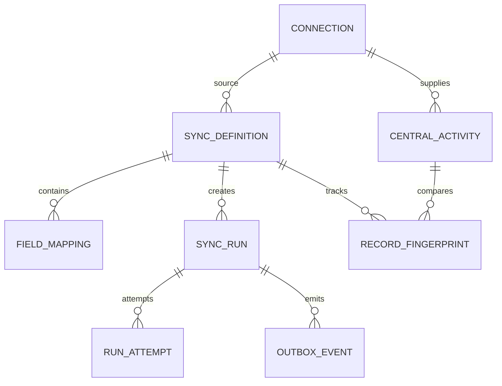
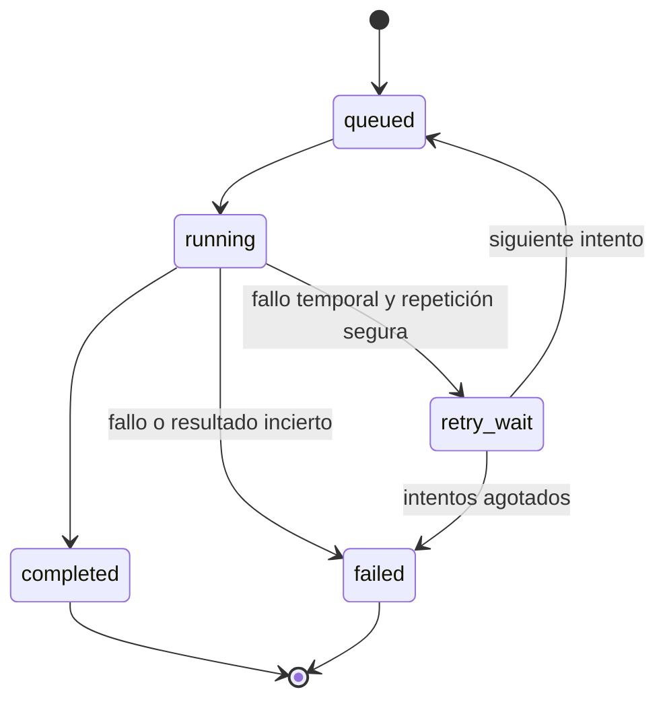

# Arquitectura

Los diagramas generales están en el [README](../README.md). Este documento explica cómo se reparte el trabajo y qué ocurre cuando algo falla.

## Servicios y datos

| Servicio | Trabajo y datos propios |
|---|---|
| Sync | Conexiones, importaciones, actividades centralizadas, comparación de datos y resultados. |
| Automation | Reglas, condiciones, acciones y su seguimiento. |
| Monitoring | Cambios, historial, avisos y estadísticas. |
| Acceso y cuentas | Registro, comprobación de contraseñas y sesiones propias, incluido en la entrada API de NestJS. |

Cada servicio se podrá ejecutar y actualizar por separado. Sync tendrá procesos en segundo plano para realizar las sincronizaciones. Se podrán añadir más si aumenta el trabajo.

Cada backend tendrá una instancia de PostgreSQL en un contenedor independiente, con credenciales, migraciones y volumen persistente propios:

| Backend | Base de datos |
|---|---|
| Sync y sus workers | PostgreSQL de Sync. |
| Automation y sus workers | PostgreSQL de Automation. |
| Monitoring | PostgreSQL de Monitoring. |
| Entrada API: cuentas y sesiones | PostgreSQL de acceso. |

Cada backend solo accede a su base. La comunicación entre servicios se realiza por HTTP y RabbitMQ, sin consultas ni transacciones entre bases. Cada base se conecta mediante una red privada a los procesos de su servicio. El frontend tendrá su propio contenedor, consumirá la API y no necesitará base de datos.

Esta separación permite gestionar cada base por separado, aunque el host y otros componentes compartidos siguen siendo dependencias comunes. Aumenta el consumo de recursos frente a una instancia compartida.

Cada cuenta tendrá sus propios recursos. El campo interno `tenant_id` identifica a su propietario.

## Fuentes y actividades centralizadas

Académico, deporte y planes sociales son tres servicios de origen, descritos en [Servicios de origen](servicios-origen.md). Pueden ser módulos del proyecto personal o servicios independientes. Son distintos de los tres componentes internos Sync, Automation y Monitoring. Las fuentes de demostración se levantarán junto al sistema con persistencia propia; Synkron solo utilizará sus API y nunca consultará sus bases directamente.

El destino inicial de las sincronizaciones es una colección interna de actividades, almacenada en PostgreSQL de Sync. El frontend consulta esa colección a través de la API general, con el propietario comprobado. Monitoring conserva el historial y los avisos; no es el almacén principal de los compromisos académicos, entrenamientos o planes.

Cada actividad debe conservar título, información temporal, tipo, estado cuando corresponda y los detalles específicos necesarios, además de propietario, fuente, identidad externa y referencia de sincronización. Se utilizará un modelo híbrido: columnas comunes para identidad, permisos, fechas y consultas conjuntas, y un campo `details` de tipo JSONB con validación según el tipo de actividad. Solo se conservarán los detalles autorizados necesarios, no la respuesta completa de cada fuente. La parte común y sus restricciones temporales se definen en [Modelo de actividades](modelo-actividades.md), según [ADR-009](decisiones.md#adr-009-modelo-híbrido-de-actividades); su migración sigue pendiente.

La identidad del registro distingue propietario, conexión, colección de origen e identificador externo. Un examen y una entrega con el mismo ID externo no se confunden, ni dos actividades de fuentes diferentes. Una nueva importación conserva el ID central. El contrato de definiciones evitará configuraciones activas con correspondencias distintas para la misma conexión y colección; sus restricciones se implementarán al crear esas tablas.

La fuente conserva la responsabilidad del dato. Una nota posterior actualiza el examen o entrega existente; un cambio de horario actualiza la misma actividad. Una sesión de estudio relacionada con una entrega es otro recurso con su propio horario: completarla no entrega la práctica. La sincronización debe conservar esa relación y sus referencias de origen sin utilizar claves foráneas entre bases.

Los instantes con hora se normalizan a UTC y se muestran en la zona del usuario. Una fecha sin hora mantiene su significado de día, sin inventar una hora límite. El contrato común distingue `date`, `instant` e `interval` y separa vencimiento de comienzo; el intervalo requiere un final posterior al comienzo. Los filtros del calendario aplicarán esas reglas al implementarse.

El calendario será una vista de consulta sobre la última información importada. Los formularios de demostración crean y modifican datos en los servicios de origen, mediante acceso autorizado; no escriben directamente en la colección central ni exponen sus credenciales al navegador. El motor no depende de los colores, etiquetas o composición visual del calendario.

Este modelo conceptual corresponde a Sync. Guarda conexiones de origen, correspondencias de campos, ejecuciones, actividades centralizadas y referencias del contenido procesado. Estas permiten distinguir registros nuevos, modificados y sin cambios. El diagrama no representa todavía tablas o migraciones implementadas para las actividades.

## Sincronización y mensajes

Sync guarda la solicitud antes de aceptarla y deja pendiente el mensaje que permitirá ejecutarla. Ambos se guardan juntos para no perder el trabajo si el sistema se interrumpe. Otro proceso envía después el mensaje a RabbitMQ.

RabbitMQ reparte las tareas entre los procesos de Sync. Automation y Monitoring reciben por separado los eventos que les interesan. Cada servicio registra los mensajes procesados para no repetir sus efectos. Si debe pedir otra acción, guarda también esa petición antes de dar el mensaje por terminado.

Sync adapta los registros de origen y guarda las actividades nuevas o modificadas en su propia base. La actualización de una actividad y el evento pendiente que la comunica se guardan en la misma transacción. Solo después de confirmar esa escritura se publica `data.changed`, con referencias de procedencia y campos afectados, sin copiar el contenido personal completo. Los eventos `sync.completed` y `sync.failed` indican el resultado de la sincronización.

Automation comprueba las reglas del usuario. La acción `notify` pide a Monitoring que guarde un aviso; `start_sync` pide a Sync otra sincronización de la misma cuenta. Las acciones conservan su origen y tienen un límite de encadenamiento para evitar bucles.

Los cambios se detectan durante cada revisión, manual al principio y programada más adelante. La primera versión no propaga borrados ni recibe cambios inmediatos mediante webhooks.

## Cuando algo falla

Sync guarda el estado de la ejecución. Monitoring lo recibe después, de modo que el panel puede tardar un poco en reflejarlo.

Los estados básicos son pendiente (`queued`), en curso (`running`), completada (`completed`) y fallida (`failed`). La espera de reintento (`retry_wait`) se añadirá con esa función.

En el flujo inicial el destino es PostgreSQL de Sync: una restricción de identidad y las transacciones permitirán reconocer las actividades ya guardadas tras una interrupción. Una lectura incompleta del origen no equivale a una confirmación de escritura de nuevas actividades.

Enviar datos a destinos externos queda como ampliación. Si se incorpora, deberá contemplar el caso en que el destino guarda un dato pero se pierde su respuesta. Solo será seguro repetir el envío cuando el destino reconozca la operación; el estado `external_outcome_unknown` se reserva para esa ampliación.

Una sincronización incompleta puede haber cambiado parte de los datos. No se presupone que todos esos cambios puedan deshacerse. Los reintentos tendrán límite y esperas entre intentos; los mensajes que sigan fallando se apartarán para revisar su causa.

## Estado de implementación y entrega

El código actual cubre cuentas y sesiones, conexiones, cifrado y prueba acotada de destinos autorizados. Existe una fuente ficticia estática de tareas. Los componentes de centralización, fuentes editables, mensajería, reglas, historial y calendario descritos aquí son el diseño pendiente.

El Hito 2 se cerrará con el alcance funcional inicial completo, no solo con la base de contenedores o una demostración parcial. El entorno deberá iniciar sus backends, bases, fuentes, RabbitMQ y frontend de forma reproducible; CI validará y publicará las imágenes en GHCR. Terraform y despliegue se trabajan después.

## Acceso y funcionamiento

El componente de acceso guarda cuentas y sesiones en su propia instancia de PostgreSQL. El panel utiliza una cookie protegida y se sirve bajo el mismo origen que la API. La sesión caduca o se invalida al cerrarla, según [ADR-005](decisiones.md#adr-005-acceso-a-la-información-personal).

Cada servicio consulta la sesión al componente de acceso por una ruta interna autenticada y comprueba la propiedad del recurso antes de operar. Esa ruta no se expone a Internet y no acepta una identidad indicada libremente por el cliente. Si la comprobación falla o el componente no responde, se rechaza el acceso. Esto añade una dependencia de disponibilidad y una consulta interna a las peticiones autenticadas.

Las tareas y los eventos internos conservan el propietario de la operación aceptada. Solo pueden publicarlos servicios autorizados, y los consumidores comprueban que las conexiones y acciones pertenecen a esa cuenta. Cerrar sesión no cancela una sincronización ya aceptada.

Las credenciales se guardarán protegidas y no aparecerán en respuestas, mensajes ni registros técnicos. Las peticiones del navegador que cambian datos requieren comprobar origen y token CSRF, además de los permisos. El inicio de sesión limita los intentos por cuenta y dirección de origen.

Las direcciones configuradas se revisarán para impedir el acceso a servicios internos. También se comprobarán los cambios de dirección durante una conexión. Las pruebas locales solo podrán acceder a los servicios simulados autorizados por el administrador.

Cada servicio tendrá comprobaciones de salud y registros técnicos propios, incluidos los necesarios para detectar una caída de Monitoring. El historial personal y los registros tendrán una conservación limitada.

Aún faltan proveedor, región, presupuesto y forma de ampliar recursos. Añadir procesos de Sync no elimina los límites de la base de datos ni de las aplicaciones conectadas.
