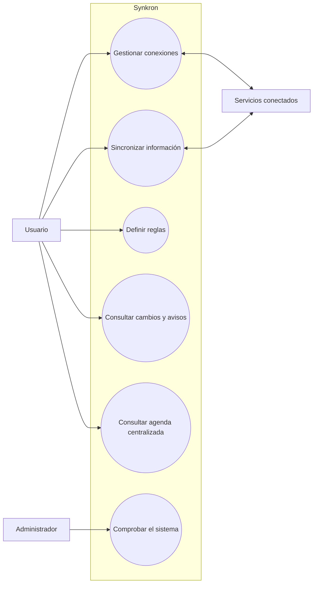

# Casos de uso

Cada persona mantiene información en sus servicios académico, deportivo y de planes sociales, y consulta juntas las actividades sincronizadas. Quien administra Synkron se ocupa de comprobar que el sistema funciona. Estos casos describen el alcance previsto; el estado implementado figura en el [README](../README.md#estado-y-cierre-de-implementación).

## Funciones previstas

| Código | Función | Resultado |
|---|---|---|
| CU-01 | Crear cuenta e iniciar sesión. | Acceder al espacio propio. |
| CU-02 | Añadir una conexión. | Guardar el servicio y proteger sus credenciales. |
| CU-03 | Probar la conexión. | Saber si responde y acepta el acceso. |
| CU-04 | Configurar una sincronización. | Elegir fuente y correspondencia con las actividades centrales de Sync. |
| CU-05 | Iniciar una sincronización. | Ejecutar en segundo plano y consultar el estado. |
| CU-06 | Programar revisiones. | Ejecutar en los momentos configurados. |
| CU-07 | Crear una regla. | Asociar condiciones y acciones a un evento. |
| CU-08 | Responder a un evento. | Realizar las acciones que correspondan. |
| CU-09 | Consultar actividad. | Ver cambios y operaciones recientes. |
| CU-10 | Revisar una operación. | Consultar resultado, duración y errores. |
| CU-11 | Reintentar una operación. | Repetir cuando sea seguro, conservando su relación con la anterior. |
| CU-12 | Desactivar una conexión o regla. | Detener nuevas operaciones sin borrar el historial. |
| CU-13 | Consultar el uso. | Ver operaciones y datos procesados por periodo. |
| CU-14 | Comprobar el sistema. | Consultar el estado de los servicios. |
| CU-15 | Introducir y modificar datos de origen. | Mantener entregas, exámenes, sesiones, deporte y planes en sus servicios. |
| CU-16 | Consultar la agenda centralizada. | Ver juntas las actividades propias y su detalle de procedencia. |
| CU-17 | Incorporar una actualización posterior. | Reflejar una nota o cambio de horario sobre la actividad existente. |

Las revisiones programadas y los reintentos manuales se añadirán después del funcionamiento básico. La cancelación queda como ampliación.

## CU-05. Iniciar una sincronización

El usuario ha iniciado sesión y tiene una sincronización activa con una conexión de origen válida. Su destino inicial es la colección central de Sync.

1. La solicita desde el panel o la API.
2. Sync comprueba los permisos, guarda la solicitud y devuelve un identificador.
3. Un proceso en segundo plano lee el origen y compara los datos con revisiones anteriores.
4. Adapta los campos y guarda las actividades nuevas o modificadas en la base de Sync, conservando identidad, propietario y procedencia.
5. Guarda los eventos pendientes junto a los cambios confirmados y registra el resultado de la ejecución.
6. Automation revisa las reglas y Monitoring actualiza la actividad.

Una configuración incorrecta se rechaza antes de ejecutar. Repetir la misma solicitud con su misma clave devuelve la ejecución ya creada.

Los fallos quedan registrados. Repetir una importación o un mensaje no crea otra actividad ni repite sus avisos. Las restricciones y transacciones del destino interno deben permitir reconocer lo ya guardado tras una interrupción.

## CU-15. Mantener datos en una fuente

1. El usuario introduce o modifica un recurso en el servicio de origen autorizado.
2. La fuente valida sus campos específicos y lo conserva con un identificador estable.
3. Una modificación actualiza ese recurso; no crea otra identidad para el mismo examen, entrenamiento o plan.
4. Al solicitar una sincronización, Sync recoge los datos y aplica la correspondencia definida.

Los formularios de demostración utilizarán un backend autorizado. Las credenciales no se entregan al navegador ni se accede directamente a las bases de las fuentes. Los campos de cada servicio se describen en [Servicios de origen](servicios-origen.md).

## CU-16. Consultar la agenda centralizada

1. El usuario consulta la agenda o el calendario a través de la API de Synkron.
2. Sync obtiene las actividades centrales de esa cuenta, filtradas por el intervalo y criterios admitidos.
3. El panel reúne datos académicos, deportivos y sociales y permite consultar sus detalles y procedencia.

La consulta utiliza lo ya sincronizado. No contacta con cada fuente al abrir la vista ni modifica registros originales. El historial operativo y los avisos se consultan en Monitoring por separado.

## CU-17. Incorporar una actualización posterior

Una nota puede ser desconocida al registrar una entrega o examen. Cuando se conoce, se actualiza en la fuente sobre el mismo recurso. La siguiente sincronización modifica la actividad central existente y comunica el cambio confirmado. Una nota cero es un dato conocido y se distingue de una nota vacía; las notas admiten como máximo dos decimales.

Cambiar el horario de un plan o corregir una sesión deportiva sigue el mismo mecanismo de identidad. Una sesión de estudio vinculada a una entrega conserva su horario y estado propios; completar esa sesión no entrega la práctica.

## CU-08. Responder a un evento

Los eventos comunican cambios confirmados o el resultado de una sincronización. Los cambios se detectan durante las revisiones.

Automation recibe el evento, comprueba si ya lo procesó y busca las reglas activas del usuario. Evalúa sus condiciones, solicita las acciones correspondientes y guarda el resultado. Monitoring reúne los avisos y la actividad.

Las acciones iniciales son crear un aviso o iniciar otra sincronización. Los envíos HTTP se añadirán después. Se conserva el origen de cada acción y se limita su encadenamiento para evitar bucles.

## Reglas de funcionamiento

| Código | Regla |
|---|---|
| RN-01 | Cada recurso pertenece a una cuenta. |
| RN-02 | Una cuenta solo puede consultar y usar recursos propios. |
| RN-03 | Desactivar una conexión o regla impide nuevas sincronizaciones o acciones automáticas y conserva el historial. |
| RN-04 | Una clave de solicitud identifica una operación durante el periodo definido. |
| RN-05 | Cada evento identifica propietario, origen, cadena de acciones y versión. |
| RN-06 | Los eventos y registros técnicos no guardan contraseñas ni todo el contenido personal. |
| RN-07 | Solo se reintentan fallos temporales cuando repetir sea seguro. |
| RN-08 | Se limitan tamaño, duración, frecuencia e intentos. |
| RN-09 | Las reglas no pueden encadenarse sin límite. |
| RN-10 | El historial solo se modifica por correcciones previstas, conservación o anonimización. |
| RN-11 | Borrar una conexión conserva las referencias necesarias para entender el historial. |
| RN-12 | Las acciones HTTP usan conexiones autorizadas. |
| RN-13 | Los cambios se comunican después de confirmar su escritura. No se propagan borrados en la primera versión. |
| RN-14 | Una actualización conserva la identidad y procedencia del recurso; registros de distintas fuentes o tipos no se confunden por compartir un ID externo. |
| RN-15 | La fuente mantiene el dato original; la agenda central inicial es de consulta. |
| RN-16 | Una nota opcional puede añadirse o corregirse sobre el mismo examen o entrega, sin crear otro compromiso. |
| RN-17 | Las sesiones de trabajo pueden vincularse a un examen o entrega, con identidad y estado independientes. |

El Hito 2 debe completar la implementación inicial de estos recorridos y sus
componentes, junto con orquestación, pruebas y CI. La sincronización hacia otro
destino externo, programación y reintentos avanzados mantienen su alcance posterior.

