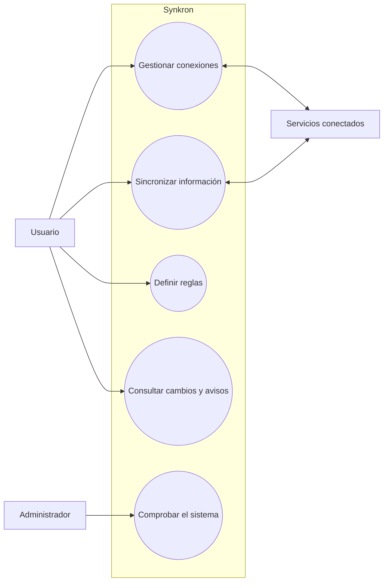

# Casos de uso

Cada persona conecta sus herramientas y consulta sus propios cambios y avisos. Quien administra Synkron se ocupa de comprobar que el sistema funciona.

## Funciones previstas

| Código | Función | Resultado |
|---|---|---|
| CU-01 | Crear cuenta e iniciar sesión. | Acceder al espacio propio. |
| CU-02 | Añadir una conexión. | Guardar el servicio y proteger sus credenciales. |
| CU-03 | Probar la conexión. | Saber si responde y acepta el acceso. |
| CU-04 | Configurar una sincronización. | Elegir origen, destino y relación entre campos. |
| CU-05 | Iniciar una sincronización. | Ejecutar en segundo plano y consultar el estado. |
| CU-06 | Programar revisiones. | Ejecutar en los momentos configurados. |
| CU-07 | Crear una regla. | Asociar condiciones y acciones a un evento. |
| CU-08 | Responder a un evento. | Realizar las acciones que correspondan. |
| CU-09 | Consultar actividad. | Ver cambios y operaciones recientes. |
| CU-10 | Revisar una operación. | Consultar resultado, duración y errores. |
| CU-11 | Reintentar una operación. | Repetir cuando sea seguro, conservando su relación con la anterior. |
| CU-12 | Desactivar una conexión o regla. | Detener nuevas operaciones sin borrar el historial. |
| CU-13 | Consultar el uso. | Ver operaciones y datos procesados por periodo. |
| CU-14 | Comprobar el sistema. | Consultar el estado de los servicios. |

Las revisiones programadas y los reintentos manuales se añadirán después del funcionamiento básico. La cancelación queda como ampliación.

## CU-05. Iniciar una sincronización

El usuario ha iniciado sesión y tiene una sincronización activa con conexiones válidas.

1. La solicita desde el panel o la API.
2. Sync comprueba los permisos, guarda la solicitud y devuelve un identificador.
3. Un proceso en segundo plano lee el origen y compara los datos con revisiones anteriores.
4. Adapta los campos y envía los datos nuevos o modificados al destino.
5. Guarda el resultado y comunica los cambios confirmados.
6. Automation revisa las reglas y Monitoring actualiza la actividad.

Una configuración incorrecta se rechaza antes de ejecutar. Repetir la misma solicitud con su misma clave devuelve la ejecución ya creada.

Los fallos quedan registrados. Si no se sabe si el destino guardó un dato, se evita repetir automáticamente salvo que pueda hacerse sin duplicarlo.

## CU-08. Responder a un evento

Los eventos comunican cambios confirmados o el resultado de una sincronización. Los cambios se detectan durante las revisiones.

Automation recibe el evento, comprueba si ya lo procesó y busca las reglas activas del usuario. Evalúa sus condiciones, solicita las acciones correspondientes y guarda el resultado. Monitoring reúne los avisos y la actividad.

Las acciones iniciales son crear un aviso o iniciar otra sincronización. Los envíos HTTP se añadirán después. Se conserva el origen de cada acción y se limita su encadenamiento para evitar bucles.

## Reglas de funcionamiento

| Código | Regla |
|---|---|
| RN-01 | Cada recurso pertenece a una cuenta. |
| RN-02 | Una cuenta solo puede consultar y usar recursos propios. |
| RN-03 | Desactivar impide nuevas operaciones y conserva el historial. |
| RN-04 | Una clave de solicitud identifica una operación durante el periodo definido. |
| RN-05 | Cada evento identifica propietario, origen, cadena de acciones y versión. |
| RN-06 | Los eventos y registros técnicos no guardan contraseñas ni todo el contenido personal. |
| RN-07 | Solo se reintentan fallos temporales cuando repetir sea seguro. |
| RN-08 | Se limitan tamaño, duración, frecuencia e intentos. |
| RN-09 | Las reglas no pueden encadenarse sin límite. |
| RN-10 | El historial solo se modifica por correcciones previstas, conservación o anonimización. |
| RN-11 | Borrar una conexión conserva las referencias necesarias para entender el historial. |
| RN-12 | Las acciones HTTP usan conexiones autorizadas. |
| RN-13 | Los cambios se comunican después de confirmar su escritura. No se propagan borrados en la primera versión. |

