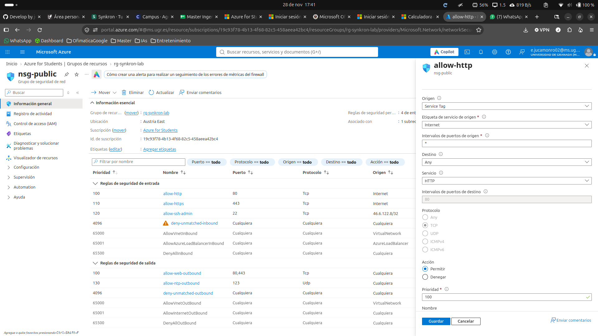
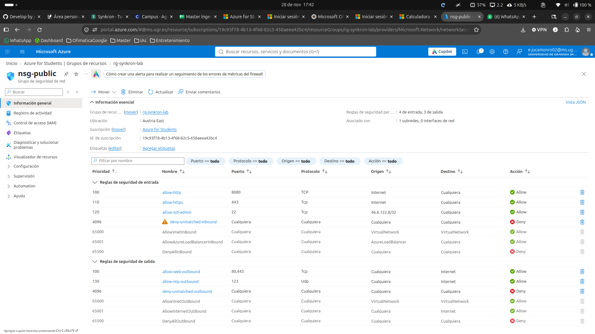

# Hito 3: aprovisionamiento y reconciliación con Terraform

El 28/11/2026 se aprovisionó un laboratorio de Azure con Terraform, se comprobó
el host de contenedores y su persistencia tras un reinicio, se indujo una deriva
desde el portal y se corrigió mediante Terraform. Finalmente se destruyeron los
28 recursos del laboratorio y se verificó la desaparición de su grupo.

La aplicación completa no se desplegó en Azure durante esta prueba. El resultado
es una infraestructura preparada para alojar contenedores, con almacenamiento
persistente y preparación automática del sistema operativo.

## Estructura y decisiones

| Configuración | Responsabilidad |
| --- | --- |
| [`bootstrap`](../infra/terraform/bootstrap/README.md) | Grupo, cuenta y contenedor del estado, permisos y backend remoto. |
| [`environments/lab`](../infra/terraform/environments/lab/README.md) | Composición de módulos, parámetros del entorno y cloud-init. |
| [`modules/network`](../infra/terraform/modules/network/main.tf) | VNet, subredes, rutas, NSG y asociaciones. |
| [`modules/compute`](../infra/terraform/modules/compute/main.tf) | Máquina Linux, interfaz e IP pública. |
| [`modules/storage`](../infra/terraform/modules/storage/main.tf) | Disco de datos y conexión a la máquina. |

Se utilizaron Terraform 1.17.2, Azure CLI 2.93.0 y AzureRM 5.15.0, con los
lockfiles versionados. La cuenta es Azure for Students. La selección de región
se contrastó con la política de regiones permitidas, disponibilidad del SKU y
cuotas de la suscripción.

El laboratorio se configuró en Austria East, zona 2: las zonas 1 y 3 figuraban
restringidas para `Standard_B2ls_v2`. El backend del estado permanece en Denmark
East. La separación de regiones no cambia la separación de estados:
`bootstrap.tfstate` y `lab.tfstate` son blobs independientes.

La máquina tiene 2 vCPU, 4 GiB y Ubuntu Server 24.04 LTS x64 Gen2. Se eligió como
punto de partida tras observar unos 1,22 GiB de RAM máxima agregada de los 28
contenedores locales durante una prueba manual corta. Esta medición no es una
prueba de carga ni garantiza capacidad para cualquier uso de Synkron.

La calculadora mostró 0,048 USD/h para esta máquina Linux en Austria East:
100 horas de cómputo equivalen a 4,80 USD, sin discos, IP pública, tráfico ni
otros consumos. Es una referencia observada en la fecha de la prueba, no un
límite de gasto ni una tarifa confirmada para Denmark East.

La red contiene subred de entrada y subred privada, tablas de rutas y NSG con
denegación general y excepciones explícitas. SSH se restringe a la IPv4 `/32`
del administrador; HTTP y HTTPS se permiten desde Internet. La subred privada
está reservada para una separación futura: no se afirma que las bases de datos
estén desplegadas en ella.

## Estado remoto y credenciales

El bootstrap prepara almacenamiento Standard LRS con contenedor privado, HTTPS,
TLS mínimo 1.2, versionado y retención de borrados de siete días. La retención
de borrados no significa que todas las versiones caduquen a los siete días.

La autenticación utiliza Azure CLI y Microsoft Entra ID. Las claves compartidas
de la cuenta están desactivadas y el acceso de datos utiliza el rol
`Storage Blob Data Contributor` al nivel del contenedor. El usuario que realizó
el aprovisionamiento mantiene permisos de propietario de la suscripción;
no se ha verificado una identidad de despliegue con permisos mínimos.

Los `.tfvars` reales, planes, estados y configuración interna de Terraform no
se versionan. Se conservan ejemplos y lockfiles. La clave privada SSH permanece
en el equipo del administrador, fuera del repositorio. Cloud-init no incluye
secretos de aplicación. Los identificadores de suscripción y la IP de la VM se
sustituyeron por marcadores en las trazas publicadas.

El bloqueo se comprobó adquiriendo un lease de 60 segundos sobre el blob del
estado del bootstrap y ejecutando un plan con espera de cinco segundos. El plan
fue rechazado con `state blob is already locked`. Al caducar el lease, el plan
volvió a finalizar sin cambios. Esto comprueba el respeto del lease de Azure y
su liberación por caducidad; no es una prueba de dos escritores Terraform
simultáneos. El [README del bootstrap](../infra/terraform/bootstrap/README.md)
detalla el procedimiento.

## Despliegue y comprobación del host

Los comandos se ejecutan desde la raíz de `Synkron`, después de preparar la
configuración local siguiendo el [README del lab](../infra/terraform/environments/lab/README.md).

```bash
terraform -chdir=infra/terraform/environments/lab init \
  -backend-config=../../../../tmp/terraform/lab.backend.hcl
terraform fmt -check -recursive infra/terraform
terraform -chdir=infra/terraform/environments/lab validate
terraform -chdir=infra/terraform/environments/lab plan \
  -out=../../../../tmp/terraform/lab-compute.tfplan
terraform -chdir=infra/terraform/environments/lab apply \
  ../../../../tmp/terraform/lab-compute.tfplan
```

La red ya estaba aplicada: el plan de ampliación creó cinco recursos sin cambios
ni bajas. Tras aplicar, se accedió por SSH y se esperó al fin de cloud-init:

```bash
terraform -chdir=infra/terraform/environments/lab output -raw public_ip_address
ssh -i ~/.ssh/synkron-lab synkron@IP_PUBLICA_VM
sudo cloud-init status --wait
```

El script espera a la conexión del disco de LUN 0, identifica su formato,
prepara ext4 si no detecta firmas, conserva un ext4 existente y registra el
UUID en `/etc/fstab`. Docker requiere ese montaje y utiliza el disco de datos.
Las comprobaciones dentro de la VM devolvieron los siguientes resultados,
transcritos de la sesión de ejecución:

```text
$ sudo cloud-init status --wait
status: done

$ findmnt /srv/synkron
TARGET       SOURCE   FSTYPE OPTIONS
/srv/synkron /dev/sdb ext4   rw,relatime

$ df -h / /srv/synkron
Filesystem      Size  Used Avail Use% Mounted on
/dev/root        30G  2.5G   28G   9% /
/dev/sdb         32G  280K   30G   1% /srv/synkron

$ sudo docker info --format 'Directorio de Docker: {{.DockerRootDir}}'
Directorio de Docker: /srv/synkron/docker

$ sudo docker compose version
Docker Compose version 2.40.3+ds1-0ubuntu1~24.04.1

$ systemctl is-active docker
active
```

### Persistencia tras reinicio

Dentro de la VM se creó un volumen y un archivo mediante un contenedor efímero:

```bash
sudo docker volume create prueba-persistencia
sudo docker run --rm -v prueba-persistencia:/datos alpine:3.22 \
  sh -c 'echo "Synkron: persistencia verificada" > /datos/prueba.txt'
sudo reboot
```

Después de volver a conectar por SSH se comprobaron montaje, servicio y archivo:

```bash
findmnt /srv/synkron
systemctl is-active docker
sudo docker run --rm -v prueba-persistencia:/datos alpine:3.22 \
  cat /datos/prueba.txt
```

La lectura devolvió `Synkron: persistencia verificada`. Esto verifica persistencia
tras reinicio y uso del host para ejecutar contenedores. No comprueba una
sustitución completa de la VM, restauración de copias ni el despliegue de las
bases de datos de Synkron.

## Experimento del patrón Reconciler

### 1. Estado deseado

Con los 28 recursos aprovisionados, el plan inicial terminó sin diferencias:

```bash
terraform -chdir=infra/terraform/environments/lab plan -no-color \
  2>&1 | tee tmp/terraform/reconciler-antes.txt
```

Resultado: `No changes. Your infrastructure matches the configuration.`
Se conserva la [traza inicial](evidencias/hito3/reconciler-antes.txt).

El código de `module.network.azurerm_network_security_rule.web["http"]`
declara TCP 80. La captura del portal anterior al cambio muestra ese estado:



### 2. Inducción manual de drift

En el portal se abrió `rg-synkron-lab` → `nsg-public` → regla `allow-http`.
Se cambió Servicio de HTTP a Custom para editar el puerto y se guardó el
intervalo de destino como `8080`, manteniendo protocolo, origen, prioridad y
acción. No se modificó el código Terraform ni la regla SSH.



### 3. Observación

Desde el equipo administrador:

```bash
terraform -chdir=infra/terraform/environments/lab plan -no-color \
  -out=../../../../tmp/terraform/reconciler.tfplan \
  2>&1 | tee tmp/terraform/reconciler-drift.txt
```

El plan detectó exactamente la discrepancia y propuso actualizar la regla:

```text
# module.network.azurerm_network_security_rule.web["http"] will be updated in-place
~ destination_port_range = "8080" -> "80"

Plan: 0 to add, 1 to change, 0 to destroy.
```

La [traza de detección](evidencias/hito3/reconciler-drift.txt) conserva el plan.
El valor real era 8080 y el deseado seguía siendo 80.

### 4. Reconciliación y verificación

Se aplicó el plan guardado y se repitió la observación:

```bash
terraform -chdir=infra/terraform/environments/lab apply -no-color \
  ../../../../tmp/terraform/reconciler.tfplan \
  2>&1 | tee tmp/terraform/reconciler-apply.txt
terraform -chdir=infra/terraform/environments/lab plan -no-color \
  2>&1 | tee tmp/terraform/reconciler-despues.txt
```

```text
Apply complete! Resources: 0 added, 1 changed, 0 destroyed.

No changes. Your infrastructure matches the configuration.
```

Se conservan las trazas de [aplicación](evidencias/hito3/reconciler-apply.txt)
y [verificación final](evidencias/hito3/reconciler-despues.txt).

Terraform consultó el estado real a través del proveedor, lo comparó con el
código y calculó una acción correctora. El `apply` restauró el puerto declarado.
En esta práctica el ciclo se ejecutó manualmente; Terraform no queda observando
y reparando la infraestructura continuamente por sí solo.

## Destrucción y verificación del apagado

Después del experimento se revisó un plan de destrucción: cero altas, cero
cambios y 28 bajas. Se ejecutó el teardown del entorno:

```bash
terraform -chdir=infra/terraform/environments/lab destroy -no-color \
  2>&1 | tee tmp/terraform/teardown-destroy.txt
```

Se confirmó con `yes` y finalizó con:

```text
Destroy complete! Resources: 28 destroyed.
```

Se conserva el [extracto de la fase de destrucción](evidencias/hito3/teardown-destroy.txt).
El disco del sistema se eliminó junto con la VM; el disco de datos y el volumen
de prueba también se eliminaron. No contienen datos de aplicación que se deban
recuperar.

Se comprobó después:

```bash
terraform -chdir=infra/terraform/environments/lab state list
az group exists --name rg-synkron-lab
```

El primer comando no devolvió recursos y el segundo devolvió `false`.
La [verificación posterior](evidencias/hito3/teardown-verificacion.txt) recoge
ambos resultados. La VM, sus discos y la IP del lab ya no permanecen activos.

La consulta posterior `az resource list` mostró únicamente:

| Grupo | Recurso | Tipo |
| --- | --- | --- |
| `rg-synkron-tfstate` | `stsynkrontfjcmr2026` | Cuenta de almacenamiento del estado. |
| `NetworkWatcherRG` | `NetworkWatcher_denmarkeast` | Network Watcher regional. |
| `NetworkWatcherRG` | `NetworkWatcher_austriaeast` | Network Watcher regional. |

No aparecieron máquinas, discos ni IP públicas. Azure puede habilitar Network
Watcher automáticamente al crear redes: su habilitación automática no añade
coste por sí sola; las funciones de diagnóstico utilizadas tienen sus propias
condiciones de facturación. Véanse la [habilitación de Network Watcher](https://learn.microsoft.com/en-us/azure/network-watcher/network-watcher-create)
y sus [precios](https://azure.microsoft.com/en-us/pricing/details/network-watcher/).
No se activaron pruebas de diagnóstico de Network Watcher durante esta práctica.
El inventario de recursos no sustituye la consulta de la facturación acumulada.

El bootstrap se conserva para reutilizar el estado remoto. Su almacenamiento,
versiones y operaciones pueden seguir generando consumo. Por tanto, la
verificación demuestra la eliminación del laboratorio, no coste total cero en
la suscripción. Para eliminar también el bootstrap hay que seguir su
[procedimiento de retirada](../infra/terraform/bootstrap/README.md), migrando
primero el estado fuera del almacenamiento que se va a destruir.

Un nuevo `terraform apply` del lab volverá a crear recursos y consumo; no es
una comprobación de apagado. Las pruebas pendientes de tráfico HTTP/HTTPS,
aislamiento efectivo de la subred privada y recuperación tras sustituir una VM
se reservan para la siguiente fase de despliegue.
